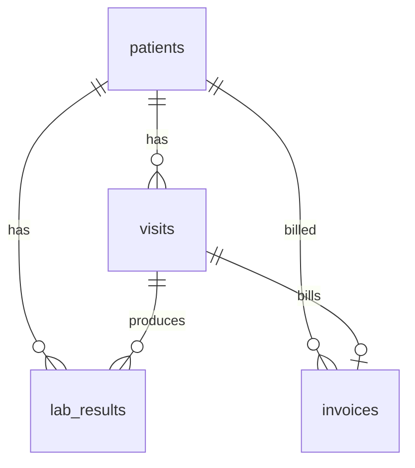
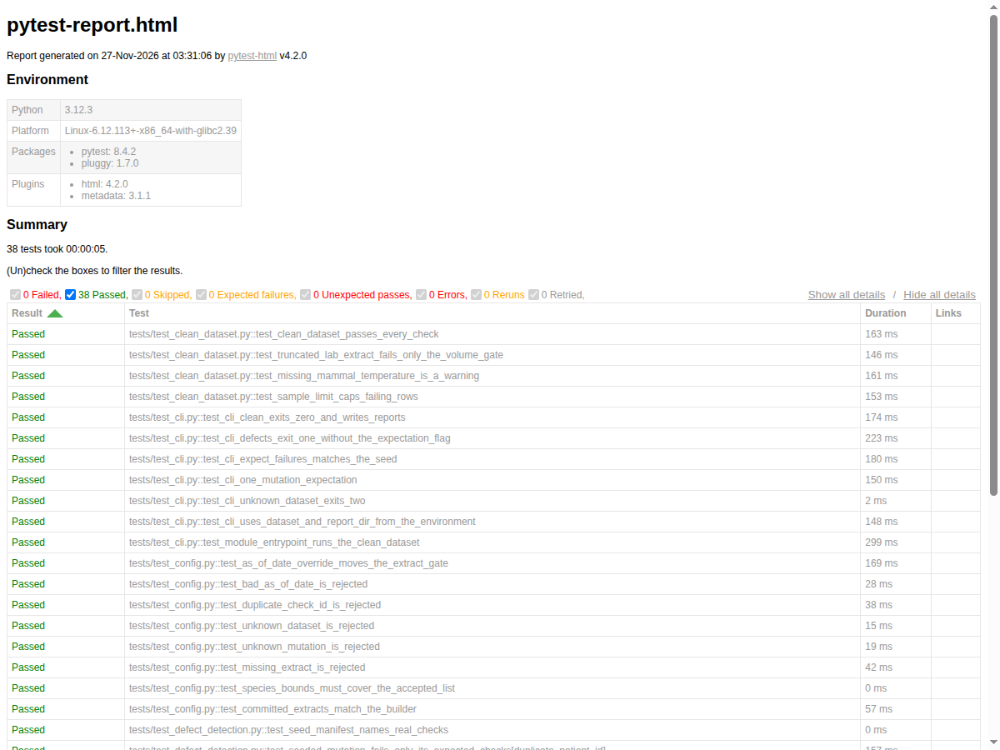
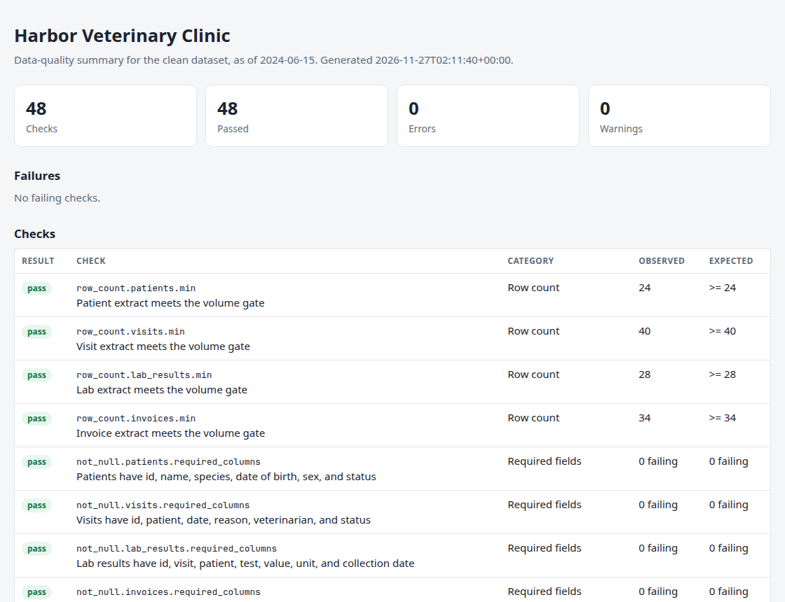
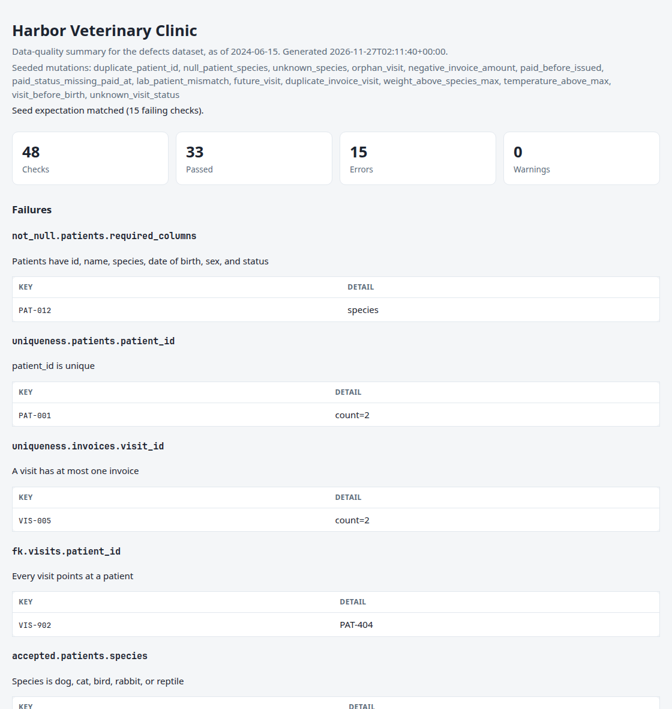

# SQL Data Quality Checks

[](https://github.com/Potucky/sql-data-quality-checks/actions/workflows/data-quality.yml)

[Live test report](https://potucky.github.io/sql-data-quality-checks/)

SQL data-quality suite for a fictional veterinary clinic. It loads patients, visits, lab results, and invoices into DuckDB and runs the same kind of warehouse checks you would point at Snowflake or PostgreSQL: volume, required fields, uniqueness, foreign keys, accepted values, ranges, date logic, and cross-table consistency.

This repository is a portfolio demo, not code from an employer. Harbor Veterinary Clinic, the rows, and the seeded defects are fictional.

DuckDB is the local stand-in for a warehouse. The staging tables are typed and permissive: primary keys and foreign keys are not enforced on load. The check suite is the gate, which is the usual split for a raw or staging layer before a stricter model.

## What this project demonstrates

- **SQL data validation.** A YAML catalog runs warehouse-style checks in DuckDB: volume, required fields, uniqueness, foreign keys, accepted values, ranges, and date logic. Dates are compared with `as_of_date` from config, so a run does not depend on the wall clock.
- **Cross-table consistency.** Domain SQL joins patients, visits, lab results, and invoices and returns rows whose patient keys, completed-visit billing, or payment status disagree.
- **Seeded negative tests.** The clean extract passes every check. Each mutation in `data/defects/seed.yaml`, applied on its own, fails exactly the checks named for that mutation, and the failing sample contains the seeded key.
- **Blocking errors and reported warnings.** An error-level failure exits 1. A warning is written into the report and still exits 0. `--expect-failures` exits 0 only when the failing set matches the seed.
- **CI test reports.** GitHub Actions lints with ruff, runs pytest, and writes a self-contained pytest-html report, JUnit XML, and HTML/JSON summaries. A push to `main` deploys the pytest HTML report and the HTML data-quality summaries to GitHub Pages.

## Stack

Python 3.11+ (CI uses 3.12), DuckDB, pytest, pytest-html, PyYAML, ruff, GitHub Actions. Dependencies are pinned in `requirements.txt`.

## Project structure

```text
config/checks.yaml          Thresholds, allow-lists, file paths
data/clean/                 Curated clinic extract (CSV)
data/defects/seed.yaml      Known-bad mutations and the checks they must fail
sql/schema.sql              Permissive staging tables
sql/domain/                 One failing-row query per business rule
src/clinic_dq/              Load, execute, report, CLI
tests/                      Clean pass, one test per defect, reports, CLI
scripts/build_sample_data.py
docs/pages-index.html       Landing page for the published HTML reports
.github/workflows/data-quality.yml
```

## Data model

Extract date: **2024-06-15**.



| Table | Rows | Grain |
| --- | --- | --- |
| `patients` | 24 | One animal. Species is dog, cat, bird, rabbit, or reptile. |
| `visits` | 40 | One appointment. Status is scheduled, completed, cancelled, or no_show. |
| `lab_results` | 28 | One test on a visit. Codes include CBC, CHEM, UA, FECAL, T4, and HW. |
| `invoices` | 34 | One bill for a completed visit. Status in this extract is paid or issued. |

Completed visits carry a weight. Dogs, cats, and rabbits also carry a temperature. Reptile visits leave temperature empty. Cancelled, no-show, and scheduled visits have no invoice.

`scripts/build_sample_data.py` is the source for the CSVs. `pytest` runs it with `--check`, so a hand-edit that drifts from the builder fails the suite.

## Checks

48 checks. The full list, with descriptions, is `config/checks.yaml` plus `sql/domain/`. The HTML report prints every result.

| Category | Checks | What it guards |
| --- | ---: | --- |
| Row count | 4 | Extract is at least the curated size, so a truncated file fails |
| Required fields | 4 | Identity and business columns are populated, one rule per table |
| Uniqueness | 5 | Primary keys, and at most one invoice per visit |
| Referential integrity | 5 | Visit, lab, and invoice foreign keys |
| Accepted values | 8 | Species, sex, statuses, currency, test code, abnormal flag |
| Ranges | 5 | Species weight bands, temperature 35–43 C, non-negative money and lab values |
| Date logic | 9 | Dates sit between birth and the extract date; payment is on or after issue |
| Consistency | 8 | Patient ids agree across tables; completed visits are weighed and billed |

Nulls belong to the required-field checks. Accepted-value and range checks skip nulls, so one empty species fails one rule. Every accepted species has a weight band. An unknown species fails the allow-list and is left out of the weight rule.

`consistency.visits.mammal_temperature_recorded` is severity `warning`. A missing temperature on a completed dog, cat, or rabbit visit shows up in the report and does not fail the command.

## Seeded defects

`data/defects/seed.yaml` applies SQL mutations on top of the clean extract. Each mutation is independent: applied alone, it fails exactly the checks named on that mutation, and the failing sample contains the seeded key.

| Mutation | Defect | Failing checks |
| --- | --- | --- |
| `duplicate_patient_id` | Second row for PAT-001 | `uniqueness.patients.patient_id` |
| `null_patient_species` | Species cleared on PAT-012 | `not_null.patients.required_columns` |
| `unknown_species` | PAT-004 species set to `dragon` | `accepted.patients.species` |
| `orphan_visit` | VIS-902 points at PAT-404 | `fk.visits.patient_id` |
| `negative_invoice_amount` | INV-003 amount set to -40 | `range.invoices.amount_non_negative`, `consistency.invoices.tax_not_above_amount` |
| `paid_before_issued` | INV-001 paid before it was issued | `date.invoices.paid_on_or_after_issued` |
| `paid_status_missing_paid_at` | INV-002 is paid with no payment date | `consistency.invoices.paid_at_matches_status` |
| `lab_patient_mismatch` | LAB-001 patient disagrees with the visit | `consistency.lab_results.patient_matches_visit` |
| `future_visit` | VIS-901 is dated 2025-01-01 | `date.visits.not_after_as_of` |
| `duplicate_invoice_visit` | Second invoice for VIS-005 | `uniqueness.invoices.visit_id` |
| `weight_above_species_max` | VIS-001 weight set to 500 kg | `range.visits.weight_kg_by_species` |
| `temperature_above_max` | VIS-003 temperature set to 50 C | `range.visits.temperature_c` |
| `visit_before_birth` | VIS-014 dated 2000-01-01 | `date.visits.on_or_after_birth` |
| `unknown_visit_status` | VIS-035 status set to `pending` | `accepted.visits.status` |

The negative amount also breaks the tax-versus-amount rule, so the fourteen mutations fail fifteen checks. Loading every mutation at once fails that same set and no others.

## Run locally

```bash
python -m venv .venv
source .venv/bin/activate
pip install -r requirements.txt
export PYTHONPATH=src

pytest
python -m clinic_dq run --dataset clean --report-dir reports/clean
python -m clinic_dq run --dataset defects --expect-failures --report-dir reports/defects
```

`make test`, `make lint`, `make report`, and `make check-data` wrap the same commands.

Exit codes:

| Code | Meaning |
| --- | --- |
| 0 | No error-level failures. With `--expect-failures`, the failing set matches the seed for the mutations that ran. |
| 1 | An error-level check failed, or `--expect-failures` did not match the seed. |
| 2 | The config or the extract could not be loaded. |

`--dataset defects` without `--expect-failures` exits 1. That is the gate behavior: the extract is bad. `--expect-failures` exits 0 when the bad rows are exactly the ones the seed describes, which is what CI uses so the defect report is produced on a green run.

Reports written to the directory:

- `dq-summary.html` — summary a reviewer can open
- `dq-summary.json` — same payload for diffing or downstream tools
- `dq-summary.txt` — the console table

## Configuration

`config/checks.yaml` holds the extract date, minimum row counts, allow-lists, ranges, and the path of each domain query. Paths are relative to the repository root, and the file must live at `config/checks.yaml`.

| Variable | Purpose |
| --- | --- |
| `DQ_CONFIG` | Catalog path. Default `./config/checks.yaml` |
| `DQ_DATASET` | `clean` or `defects` when `--dataset` is omitted |
| `DQ_AS_OF_DATE` | Overrides `as_of_date` (`YYYY-MM-DD`) |
| `DQ_REPORT_DIR` | Output directory when `--report-dir` is omitted |

```bash
DQ_AS_OF_DATE=2020-01-01 PYTHONPATH=src python -m clinic_dq run --dataset clean --report-dir reports/as-of-2020
```

That run fails the date gates and leaves the volume gates passing. The suite covers this override.

## Continuous integration

`.github/workflows/data-quality.yml` runs on push and pull request. It lints with ruff, runs pytest with JUnit XML and a self-contained pytest-html report, writes the clean summary, writes the defect summary with `--expect-failures`, and uploads `reports/` as the `data-quality-reports` artifact.

On a push to `main`, the `pages` job runs pytest again, writes the clean and defect summaries, and deploys the HTML report. It writes `index.html` from `docs/pages-index.html`, then publishes that page plus the pytest report and both data-quality summaries with `actions/upload-pages-artifact` and `actions/deploy-pages`. The job's token has `contents: read`, `pages: write`, `id-token: write`, and `actions: read` (so the deploy step can download the uploaded artifact). The [live test report](https://potucky.github.io/sql-data-quality-checks/) updates after that job runs on `main`. GitHub serves the site only when the repository Pages source is GitHub Actions.

The badge tracks the default branch and updates after this workflow is on that branch.

pytest HTML report from a local run:



## Sample output

Clean extract, 48 checks, none failing:



Seeded defects. Fifteen error checks fail, the samples name the bad keys, and the header records that this set matches the seed:



Console excerpt:

```text
Harbor Veterinary Clinic — data-quality summary
dataset: clean
as_of_date: 2024-06-15
checks: 48  passed: 48  failed: 0  errors: 0  warnings: 0

PASS  row_count.patients.min  [error]  observed=24  expected=>= 24
PASS  fk.visits.patient_id  [error]  observed=0 failing  expected=0 failing
PASS  consistency.visits.mammal_temperature_recorded  [warning]  observed=0 failing  expected=0 failing
```

```text
dataset: defects
checks: 48  passed: 33  failed: 15  errors: 15  warnings: 0
Seed expectation matched (15 failing checks).

FAIL  fk.visits.patient_id  [error]  observed=1 failing  expected=0 failing
      Every visit points at a patient
      VIS-902  PAT-404
FAIL  range.invoices.amount_non_negative  [error]  observed=1 failing  expected=0 failing
      Invoice amount is zero or positive
      INV-003  -40.00
FAIL  consistency.invoices.tax_not_above_amount  [error]  observed=1 failing  expected=0 failing
      Tax does not exceed the invoice amount
      INV-003  tax=19.20 amount=-40.00
```

## How the tests are organized

`tests/test_clean_dataset.py` loads the curated extract and requires all 48 checks to pass, including the warning. Deleting one lab row fails only `row_count.lab_results.min`. Clearing a dog's temperature fails only the warning, and that result is not a blocking failure.

`tests/test_defect_detection.py` applies each mutation by itself and requires the failing check ids to equal that mutation's `expect_failed_checks`, with the seeded key in the sample. A second test applies every mutation and requires the failing set to equal the union (15 checks), with no repeated sample row.

`tests/test_config.py` covers a bad as-of date, a duplicate check id, a missing CSV, an unknown mutation, and species bounds that must cover the accepted species list. `tests/test_report.py` checks the JSON summary and that failure text is escaped in the HTML. `tests/test_cli.py` checks exit codes, `--expect-failures`, environment defaults, and `python -m clinic_dq`.

There are no sleeps. Nothing in the suite calls the network.

## Scope

The suite is a local, deterministic demo of warehouse-style data QA:

- One as-of date and one curated extract, with volume gates equal to that extract
- Lab values are checked as non-negative numbers plus an allow-list on the abnormal flag. Clinical reference ranges per test are left out
- Domain SQL returns columns `entity_key` and `detail`. Adding a rule is a YAML entry, or a SQL file plus a YAML entry when the rule needs a join

## Author

Vasyl Popovich, QA Automation Engineer, Miami, FL. GitHub: https://github.com/Potucky
